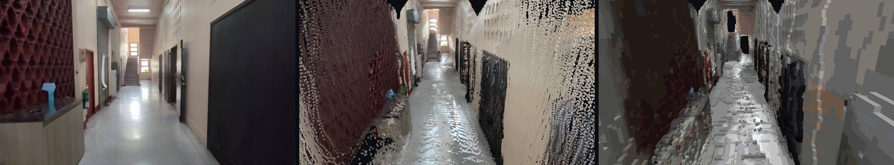
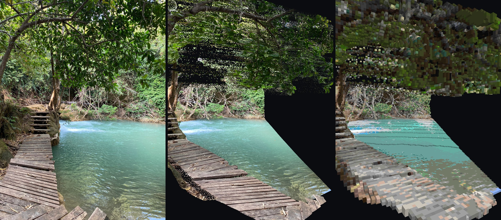
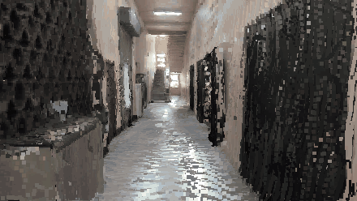
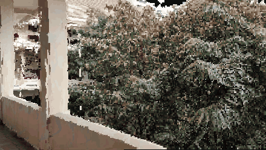
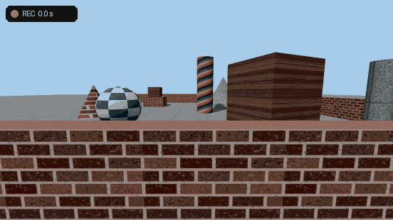
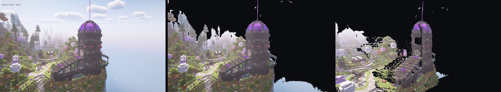
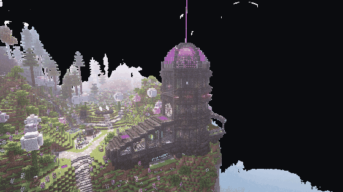

# BlockShot

**Turn images and videos into Minecraft builds.**

Drop in a screenshot, a photo or a walk-through video. A 3D model rebuilds the scene as a point cloud,
BlockShot turns the cloud into blocks, and you get a WorldEdit schematic. Stand where the camera was,
and the build lines up with the original picture. Walk away, and it turns out to be a sculpture of
what that one camera saw.



*Left: a frame of a walk-through video. Middle: the whole scene's point cloud, seen from a step back,
a little above and to the side. Right: its Minecraft build, from the same spot.*

> A personal prototype, developed and tested on Windows with an RTX 3080 Laptop GPU (16 GB). Expect
> rough edges.

## What it does

- **Image → Minecraft build.** One picture becomes a point cloud and a block build you can paste in
  game, lined up with your view.
- **Video → one scene.** A walk-through clip becomes one consistent scene, viewable from any of its
  frames, and a build from any of them.
- **Playground.** A small 3D world inside the app: build a scene, walk through it, record, and see
  the reconstruction scored against the exact ground truth.
- **3D lab.** Compare models side by side, with depth, normal and analysis maps. Where the project
  started: studying how 3D models read optical illusions.

## Quick start

You need [uv](https://docs.astral.sh/uv/), Node.js, and ideally an NVIDIA GPU; everything also runs on
CPU, slowly. PyTorch comes from the CUDA 13.0 wheel index, which needs NVIDIA driver 580 or newer.

```bash
uv sync
```

**Windows:** double-click **`run.bat`**. It starts the backend (:8000) and the web app (:5173) in two
windows and opens http://localhost:5173. Close both windows to stop.

**Anywhere else:**

```bash
uv run uvicorn backend.app:app --port 8000
cd frontend && corepack pnpm install && corepack pnpm dev   # http://localhost:5173
```

Model weights download from Hugging Face on first use.

## Image → Minecraft build

1. Drop an image on the drop zone, keep **moge** ticked (recommended), and press **Run**.
2. Pick a block size in the **Minecraft build** bar (**Auto** is fine to start), tick **Show as
   blocks** to preview, and press **Snap to input camera** to see it from where it matches.
3. Press **Download .schem** on the run's card. Big builds come as a zip of 128 × 128 tiles.



*Left: the photo. Middle: its point cloud, seen from 30° to the side. Right: the Minecraft build, from
the same spot.*

Then, in Minecraft with [WorldEdit](https://enginehub.org/worldedit):

1. Put the file in `.minecraft/config/worldedit/schematics/` (singleplayer mod) or the server's
   `plugins/WorldEdit/schematics/`.
2. Stand where the picture should be seen from, and turn to the yaw and pitch on the card:
   `/tp @s ~ ~ ~ <yaw> <pitch>`.
3. `//schem load <file name>`, then `//paste`. The paste is offset so the image's camera lands at
   your eyes. For tiles, load and paste each one without moving; they assemble around you.
4. Set **Options → FOV** to the number on the card, turn **FOV Effects** off, and press **F1** to
   hide the HUD.

Schematics load in Minecraft 1.20 and newer. More on block sizes, the palette and the models:
[docs/builds.md](docs/builds.md).

## Video → one scene

Drop an `mp4`, `mov` or `webm` instead of an image. All frames are placed in one scene; pick any
frame to view the scene, and its build, from that frame's camera.

 

*Walking through two reconstructed clips, each built from its frames' depth and camera poses.*

Move slowly, with each moment overlapping the last. For game footage, hide the HUD and enter the
game's **Vertical FOV** if you know it. Options, recording tips and how it works:
[docs/video.md](docs/video.md).

## Worlds

Record a big place over several sessions and join the videos into one map on the **World** tab: each
new scene is placed where its roofs match, then you confirm or nudge it. With **Boxes** shape,
buildings become solid prisms. See [docs/world.md](docs/world.md).

## Playground

Switch the sidebar to **Playground** for a small first-person world: presets or your own blocks,
**WASD** to walk, **R** to record. The recording goes through the video pipeline, and because the app
drew the scene, the result is scored against the exact camera path and surfaces.



Game-like nuisances (HUD, swinging arms, head bob, fast turns) can be switched on to test gameplay
footage. Details and measurements: [docs/playground.md](docs/playground.md).

## 3D lab

Tick up to four runs in History to compare them side by side, in RGB, depth, confidence or analysis
colours, with their maps underneath. See [docs/lab.md](docs/lab.md).


A single picture's point cloud only holds what that camera saw: from the camera it matches the input
exactly, and from the side it turns out to be a façade.



*Left: the input screenshot. Middle: the point cloud, seen from the input camera. Right: the same
cloud from 30° to the side.*



## What works, and what doesn't yet

- **Works well:** screenshots and photos with clear structure; slow walk-throughs of rooms, hallways
  and streets.
- **A build is one view deep.** Surfaces are one block thick, and nothing exists behind what the
  camera saw.
- **Real-size builds are approximate.** Metres from a single camera can be 15–50% off.
- **Frantic gameplay doesn't map yet.** Swinging arms, changing HUDs, snap turns and respawns break
  the camera tracking.
- **Wide fields of view** (many games) are guessed too narrow unless you enter the FOV.
- **Circling an object up close** gives frames that disagree, and holes where they do.

## For developers

The backend is FastAPI (`backend/`), the web app Vite + React + three.js (`frontend/`).

| Where | What |
|---|---|
| `backend/minecraft.py` | point cloud → levelled blocks → schematic ([docs/builds.md](docs/builds.md)) |
| `backend/video.py` | frames → VGGT poses and depth, sky and ghost removal, levelling ([docs/video.md](docs/video.md)) |
| `backend/playground.py` | ground-truth ray casting and scoring ([docs/playground.md](docs/playground.md)) |
| `backend/models/` | MoGe, VGGT, Depth Anything, Marigold wrappers |
| `backend/analysis/` | integrability, tears, off-axis renders ([docs/lab.md](docs/lab.md)) |
| `backend/app.py` | the HTTP API ([docs/api.md](docs/api.md)) |
| `tools/bakeoff/` | the gameplay-footage model comparison |

```bash
uv run pytest                                                 # model tests download weights on first run
uv run python tools/readme_media.py build <run> <out.jpg>     # README pictures: triptych, build, scene, orbit, walk
uv run python tools/minecraft_palette.py <minecraft.jar>      # re-measure the block palette
```

## License

The code is [MIT](LICENSE). Model weights keep their own licences (see
[docs/builds.md](docs/builds.md#models)); some, such as VGGT-1B and Depth Anything Base/Large, are
non-commercial.

Minecraft is a trademark of Mojang Studios. BlockShot is not affiliated with Mojang or Microsoft.
