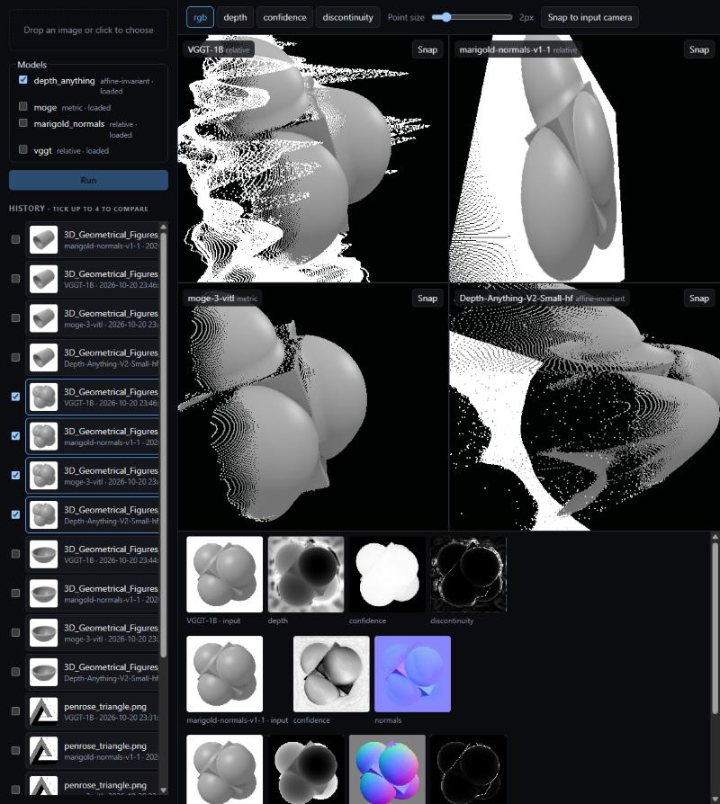

# Image → 3D Point Cloud Playground

Run single-image depth/geometry models on images (especially impossible figures), cache the
outputs in one uniform format, and inspect them.

## Setup

Requires [uv](https://docs.astral.sh/uv/). Torch is pulled from the CUDA 13.0 wheel index (NVIDIA driver 580+);
the device is picked at startup (CUDA → MPS → CPU).

```bash
uv sync
uv run python samples/generate.py   # draws penrose_triangle.png, necker_cube.png
```

## Use

On Windows, double-click **`run.bat`**. It starts the backend (:8000) and the viewer (:5173), each in
its own window, and opens http://localhost:5173. Close the two windows to stop the servers.

Manually:

```bash
uv run python -m backend.cli predict samples/penrose_triangle.png --model depth_anything
uv run uvicorn backend.app:app --port 8000
uv run pytest
```

Viewer (needs Node and pnpm; `corepack pnpm` works without a global install):

```bash
cd frontend && corepack pnpm install && corepack pnpm dev   # http://localhost:5173, proxies /api to :8000
```

The viewer renders with a projection built from the run's intrinsics, so **Snap to input camera**
(camera at the origin looking down +Z) reproduces the input image pixel-for-pixel. Color modes:
RGB, depth, confidence (when the model has it), discontinuity.

Navigation: drag to orbit, right-drag to pan, scroll to zoom. **W/A/S/D** fly, **Q/E** down/up,
**Shift** faster (keys drive the viewer under the mouse; in the grid the others follow). The second
toolbar row sets move, orbit, zoom and pan sensitivity, remembered per browser. Move speed is in
median-depths per second, so it feels the same for metric and relative models.

Each run lands in `runs/<image sha>_<model>_<version hash>/` with `prediction.npz`,
`points.ply` (RGB-colored, camera frame: +X right, +Y down, +Z forward), `input.png` and
`meta.json`. Re-running the same image and model hits the cache; pass `--force` to recompute.

## Analysis

Computed on first request per run and cached in `runs/<id>/analysis.json` (+ `analysis.npz`).
`GET /runs/{id}/analysis` returns the summary; each panel shows it in its header.

- **Integrability** (`backend/analysis/integrability.py`), the core research signal. For each run it
  builds a gradient field of log-depth twice: *native* from the model's normals, *derived* from its
  depth. It then computes the curl and a Helmholtz–Hodge split: a Poisson solve with Neumann
  boundaries over the mask, via `scipy.sparse`. It reports the non-integrable residual energy as a
  fraction of the total.
  - Deviation from the plan: the native gradient uses the perspective-exact
    `∇log z = −(n_x, n_y)/(n·r)` (r = the pixel's ray) rather than the orthographic `−n_x/n_z`. Only
    the former is curl-free for every real surface under a perspective camera; near the optical axis
    they agree.
  - Depth-derived gradients are integrable by construction: their residual is 0 to solver precision.
  - Curl and residual maps are stored relative to the run's RMS gradient and shown on a fixed scale,
    so ~0 really looks like 0 and runs compare directly. Viewer modes: **curl** (signed) and
    **residual**.
  - Tests: an exact perspective sphere gives 0.05% residual. The hand-built Penrose normal field
    (`tests/fixtures/fields.py`) gives 22%, spread over all three bars of the loop (33 / 27 / 40%),
    even though every local join is a valid fold.
- **Reprojection** (`reproject.py`): mean px error of points projected through the run's intrinsics.
  It is 0.000 px for every depth model.
- **Discontinuity / tears** (`discontinuity.py`): the largest 3D distance to a 4-neighbor divided by
  depth, plus the top 20 tears found by greedy non-max suppression (8 px). The **Tears** toggle marks
  them in 3D and on the input, and lists their pixel coordinates.
- **Off-axis renders** (`offaxis.py`): the cloud re-rendered through the same intrinsics after
  rotating it ±5°, ±15° and ±30° about the vertical axis through its centroid. Saved to
  `runs/<id>/offaxis/yaw_±NN.png` (`POST /runs/{id}/offaxis`, or the button in the strip).

First numbers on `samples/penrose_triangle.png`: MoGe-3 normals leave 6.0% non-integrable and
Marigold normals 11.1%. Depth Anything, VGGT and MoGe depth all give 0% (as they must).

## Telephone game

Select one or more runs, then press **Play** in the bar above the image strips. Each model renders
its own point cloud **Turn** degrees to the side, has that render fed back to it as a new photo, and
repeats **Steps** times. Rotation and mistakes both accumulate: walls bend, scenes curl into
ribbons, and each model drifts in its own style. **Generation** scrubs every panel through the steps
together (**Loop** animates it), and the strip shows each frame a model was fed; click one to
enlarge it.

- Only pinholes between rendered points are patched before feeding a frame back. Real gaps stay
  grey, so the model has to cope with them.
- Generations are ordinary cached runs tagged `meta.telephone = {root, step, yaw}`, hidden from
  History. Replaying a chain is instant. `POST /runs/{id}/telephone?steps=&yaw=`.

## Minecraft build

Turns a run into a Minecraft build that looks like the input image from one spot, the original
camera. Set **Size** (blocks along the longest side) in the bar above the strips. **Show as blocks**
previews the build as cubes in every panel, and each strip has **Download .schem** with
instructions:

1. Put the file in `.minecraft/config/worldedit/schematics/` (WorldEdit mod) or a server's
   `plugins/WorldEdit/schematics/`.
2. Stand where the photo was taken from and face south: `/tp @s ~ ~ ~ 0 0`.
3. `//schem load <name>`, then `//paste`. The paste offset puts the photo's camera at your eyes.
4. Set FOV to the value the card shows (the input camera's vertical field of view), turn FOV
   Effects off, and press F1.

How it works (`backend/minecraft.py`):

- The cloud is snapped to a block grid in Minecraft's axes, with the camera facing south. The
  outermost 0.5% of points on each axis are ignored when sizing the build.
- Each block's colour is the mean of its points in linear light. The block is the closest palette
  entry in CIELAB.
- The output is a Sponge v2 schematic (DataVersion 2586, Minecraft 1.16.5; newer versions upgrade
  it on load).
- The palette (`backend/minecraft_palette.json`) holds the mean texture colours of 107 full,
  same-on-every-face, non-falling, non-glowing blocks. `tools/minecraft_palette.py` measures them
  from a Minecraft jar you own; only the numbers are stored.
- It's a single-view build: surfaces are one block thick and nothing is built behind what the camera
  saw.

## API

| Route | |
|---|---|
| `GET /models` | models, load status, device, scale kind |
| `POST /models/unload?name=` | free a model (or all) |
| `POST /predict` | multipart `image`, `models` (repeatable), `force` |
| `GET /runs`, `GET /runs/{id}` | run metadata |
| `GET /runs/{id}/points.bin?stride=` | `uint32 N, has_conf`, `f32 xyz[3N]`, `f32 discontinuity[N]`, `f32 conf[N]` (if any), `u8 rgb[3N]`; ≤500k points |
| `GET /runs/{id}/maps/{depth,confidence,normals,discontinuity,curl,residual}.png` | display-normalized 2D maps |
| `GET /runs/{id}/analysis?force=` | reprojection, integrability, top tears |
| `GET /runs/{id}/field/{curl,residual}.bin` | `f32[N]` per point, same order as `points.bin` |
| `GET /runs/{id}/minecraft.{json,bin,schem}?size=` | Minecraft build: summary, block preview, Sponge schematic |
| `POST /runs/{id}/offaxis` | renders the ±5/15/30° views, returns their URLs |

## Models



Tick up to four runs in History (or run several models at once) for the comparison grid. Orbiting
one panel orbits all of them; poses are shared in units of each cloud's median depth, so metric and
relative models stay aligned. Each panel has its own Snap.

VRAM measured on an RTX 3080 Laptop (16 GB), CUDA. All four resident ≈ 10.6 GB.

| Name | Weights | License | Output | Weights / peak VRAM |
|---|---|---|---|---|
| `depth_anything` | Depth-Anything-V2-Small-hf (`DEPTH_ANYTHING_SIZE=Base\|Large`) | Small: Apache-2.0; Base/Large: CC-BY-NC-4.0 | affine-invariant disparity, assumed 60° FOV | 0.1 / 0.2 GB |
| `moge` | Ruicheng/moge-3-vitl (MoGe 3.0.0) | MIT (DINOv2 parts Apache-2.0) | metric pointmap, intrinsics, mask, normals | 1.4 / 2.4 GB |
| `marigold_normals` | prs-eth/marigold-normals-v1-1 (4 steps, ensemble 3) | CreativeML Open RAIL++-M | normals + uncertainty only (points are a placeholder plane) | 2.4 / 3.8 GB |
| `vggt` | facebook/VGGT-1B, single image | weights non-commercial; code see repo | depth, confidence, intrinsics (camera head) | 4.7 / 7.0 GB |

Notes:
- Depth Anything predicts disparity. `depth = 1/disparity`; raw disparity is kept as `raw_disparity`.
- MoGe-3's refinement stage needs CUDA (Triton kernels via flex-gemm). On CPU it runs with
  `refine_steps=0`; the setting is part of the cache key and `meta.refine_steps`.
- Marigold normals are converted from (right, up, toward viewer) to the OpenCV camera frame.
- VGGT's `depth_conf` (≥ 1, unbounded) is stored raw as `raw_depth_conf`; `confidence = 1 - 1/depth_conf`.
- PyTorch comes from the CUDA 13.0 wheel index (MoGe requires it); `vggt`'s `numpy<2` pin is overridden.
- DUSt3R/MASt3R (optional in the plan) are not included.
