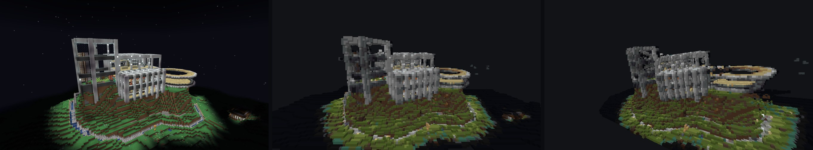

# BlockShot

**Turn any image into a Minecraft build that looks exactly like it from one spot.**

Drop in a screenshot, a photo or a painting. A monocular 3D model rebuilds the scene as a point
cloud, BlockShot turns that cloud into blocks, and you get a WorldEdit schematic. Paste it, stand
where the camera was, and the build lines up with the original image. Walk away, and it falls apart
into the façade it really is.

Or drop in a **video**: a walk through a room, or a screen recording of a game. BlockShot aligns the
frames into one scene and builds the whole space, viewable from any frame.



*Left: the input screenshot. Middle: the generated build, seen from the input camera. Right: the same
build from 30° to the side.*

## Quick start

You need [uv](https://docs.astral.sh/uv/), Node.js, and ideally an NVIDIA GPU. It was developed on
an RTX 3080 Laptop (16 GB); everything also runs on CPU, slowly. PyTorch comes from the CUDA 13.0
wheel index, which needs NVIDIA driver 580 or newer.

```bash
uv sync
```

**Windows:** double-click **`run.bat`**. It starts the backend (:8000) and the web app (:5173) in two
windows and opens http://localhost:5173. Close both windows to stop.

**Anywhere else:**

```bash
uv run uvicorn backend.app:app --port 8000
cd frontend && corepack pnpm install && corepack pnpm dev   # http://localhost:5173
```

Model weights download from Hugging Face on first use.

## Make a build

1. Drop an image on the drop zone, keep **moge** ticked (recommended), and press **Run**. Anything
   slow (loading weights, predicting, building, exporting) shows a progress bar.
2. In the **Minecraft build** bar under the 3D view, choose how big a block is:
   - **Auto** (default): about *N* thousand blocks in total, 50k–4M. Detail follows the scene, so a
     city and a room both get a few hundred thousand blocks.
   - **Real size**: one block = *x* metres. Metric models (MoGe, video scenes) only.
   - **Fit longest side**: the longest side is *N* blocks.

   A budget of 4M blocks enlarges the blocks, with a warning, if a setting would go past it.
3. Tick **Show as blocks** to preview the build in 3D, and press **Snap to input camera** to see it
   from the spot where it matches. Previews above 400k blocks merge blocks into bigger cubes;
   downloads are always full detail.
4. Press **Download .schem** on the run's card. Builds wider or longer than 128 blocks come as a
   **zip of 128 × 128 tiles** instead, with a `paste-commands.txt`.

Then, in Minecraft with [WorldEdit](https://enginehub.org/worldedit):

1. Put the file in `.minecraft/config/worldedit/schematics/` (singleplayer mod) or the server's
   `plugins/WorldEdit/schematics/`.
2. Stand where the picture should be seen from, and turn to the yaw and pitch on the card:
   `/tp @s ~ ~ ~ <yaw> <pitch>`.
3. `//schem load <file name>`, then `//paste`. The paste is offset so the image's camera lands at
   your eyes. For tiles, load and paste each one without moving: every tile carries its own offset
   from the same standing spot, so they assemble around you.
4. Set **Options → FOV** to the number on the card (the camera's vertical field of view), turn
   **FOV Effects** off, and press **F1** to hide the HUD.

Schematics use Minecraft 1.20.1 block data (DataVersion 3465) and load in 1.20 and newer. A
build taller than 384 blocks (the world's build height) gets a warning.

## From a video

Drop an `mp4`, `mov` or `webm` instead of an image. The options:

- **Frames/s** (default 2) and **Max frames** (default 60): how densely the clip is sampled.
  Near-duplicate frames (a camera standing still) are dropped.
- **Geometry:** *VGGT depth* (default: the frames agree with each other) or *MoGe detail* (sharper
  per-frame depth bent onto VGGT's shape, but with more ghosting).
- **Ignore a static game HUD** (on): pixels that stay still while the picture moves, such as a
  crosshair, hotbar or minimap, are left out of the scene.

The result is a **scene**: one point cloud from all frames, shown with a **View from frame** slider
and a strip of the sampled frames. Click a frame to view the scene, and its build, from that frame's
camera. The Minecraft build is seen from the chosen frame, with floors levelled from the average
camera "up". Stand there in game the same way as for an image.

How it works (`backend/video.py`):

1. VGGT reads all frames in one pass (up to 96; longer clips go in overlapping chunks of 64, joined
   with a similarity fit on the shared frames). It gives every frame's camera pose and depth in one
   frame of reference, so a frame that comes back to something already seen agrees with the first
   view of it.
2. MoGe, on six frames, sets the scale in metres.
3. **Ghost removal.** A point that lands clearly in front of what two or more other frames saw there
   (space they looked straight through) is dropped. This also removes people walking through the
   shot, leaving gaps where they stood.
4. Each frame's pixels are placed with its VGGT pose. Builds fill the surface between neighbouring
   pixels of each frame, so close walls don't come out as sparse dots.

Why VGGT's depth and not MoGe's: on a 24-frame clip of a kitchen, walking and turning around, two
frames agree within 5% on 62% of the points they share when each frame uses MoGe's depth. 12.8% of
points float in space another frame saw as empty, and those ghosts are what makes objects come out
doubled and see-through. MoGe's guess bends the room a little differently in every frame, and no
per-frame scale fixes a bend. VGGT's depth is predicted together with the poses: 85% agree and 2.9%
float; with ghost removal, 90% and 0.4%, keeping 94% of the pixels. It is faster too: 47 s instead
of 104 s for that clip.

Measured on an RTX 3080 Laptop (16 GB) with a synthetic 10 s room walkthrough rendered from known
camera poses (20 frames at 640 × 360):

| | |
|---|---|
| Total time (MoGe depth on every frame, before ghost removal) | 51 s: poses 15 s, depth 34 s |
| Camera rotation error | 0.7° (median) |
| Camera position error | 2.8 cm (RMS, after aligning scale) |
| Surface error | 24–28 cm (median) |
| VGGT, 64 frames in one pass | 26 s, 9.8 GB peak VRAM |

**Limits.** Fast motion, motion blur and blank walls can throw the poses off. Keep the camera moving
slowly, with each frame overlapping the last. MoGe's metres were 1.56× off on the synthetic room, so
treat real-size builds from video as approximate. Ghost removal compares every frame with every
other, so it grows with the square of the frame count: 7 s for 24 frames, roughly 40 s for 60.

## How a build is made

`backend/minecraft.py`:

1. **Point cloud.** The chosen model predicts a 3D point for every pixel, in the camera's frame.
2. **Axes.** The cloud is turned into Minecraft's axes with the camera facing south (+z), so the
   image's right side goes west. Video scenes line the grid up with the first frame, with "up"
   averaged over all frames, and are built once: choosing another frame only changes where you
   stand, your yaw and pitch, and the FOV.
3. **Blocks.** The surface between neighbouring pixels is filled in, except across depth jumps, and
   snapped to a grid whose spacing comes from the block-size setting. The outermost 0.5% of points on
   each axis are ignored, so stray points don't shrink the build, and blocks within 4 of the eye are
   dropped so they don't fill the view in game.
4. **Colours.** Each block's colour is the mean of its points in linear light. The block placed is
   the palette entry closest in CIELAB, a perceptual colour space.
5. **Schematic.** A Sponge v2 `.schem` with WorldEdit's paste offset set from the camera position,
   and the vertical FOV from the model's estimated camera. Tiles each carry the global offset plus
   their own origin.

The palette (`backend/minecraft_palette.json`) holds 153 blocks from 1.20.1: all concrete, wool,
terracotta and planks, plus deepslate, tuff, mud bricks, waxed copper, stones, bricks, storage blocks
and others that look the same on every face and don't
fall, glow, or let light through. Each entry is the mean colour of the block's texture, measured from
a Minecraft jar by `tools/minecraft_palette.py`. Only those numbers are in this repo, no game files.

**What to expect.** A build is a single-view sculpture: surfaces are one block thick, and nothing
exists behind what the camera saw. The image's own lighting is baked into the block choice, and
Minecraft shades block faces again, so faces can come out slightly darker in game.

## Models

| Model | Weights | Output | Licence | VRAM (weights / peak) |
|---|---|---|---|---|
| **`moge`** · *recommended* | Ruicheng/moge-3-vitl (MoGe 3.0.0) | metric point map, camera intrinsics, mask, normals | MIT (DINOv2 parts Apache-2.0) | 1.4 / 2.4 GB |
| `depth_anything` | Depth-Anything-V2-Small-hf (`DEPTH_ANYTHING_SIZE=Base\|Large`) | relative depth; assumes a 60° camera | Small: Apache-2.0; Base/Large: CC-BY-NC-4.0 | 0.1 / 0.2 GB |
| `vggt` | facebook/VGGT-1B, single image | depth, confidence, intrinsics | weights non-commercial | 4.7 / 7.0 GB |
| `marigold_normals` | prs-eth/marigold-normals-v1-1 | surface normals only (no depth, so no build) | CreativeML Open RAIL++-M | 2.4 / 3.8 GB |

MoGe gives the best-looking builds: it estimates the real camera, so the FOV and proportions come out
right, and it masks out sky and empty background. All four models loaded together use about 10.6 GB
of VRAM.

Notes:

- Depth Anything predicts disparity; `depth = 1/disparity`, and the raw disparity is kept.
- MoGe's refinement stage needs CUDA (Triton kernels). On CPU it runs without refinement, and that
  setting is part of the run's cache key.
- VGGT's depth confidence is stored raw and mapped to `1 − 1/conf` for display.
- `vggt`'s `numpy<2` pin is overridden in `pyproject.toml`; it runs fine on numpy 2.

## Also in the box: a single-image 3D lab

BlockShot grew out of a playground for studying how these models handle images, especially optical
illusions and impossible figures. All of that is still here.


- **Exact camera.** The 3D view projects through each run's own intrinsics, so **Snap to input
  camera** reproduces the input pixel for pixel.
- **Comparison grid.** Tick up to four runs in History. Moving in one panel moves all of them;
  poses are shared in units of each cloud's median depth, so metric and relative models stay aligned.
- **Navigation.** First person: drag to look around from where you stand, scroll to move forward
  or back. **W/A/S/D** fly, **Q/E** down/up, **Shift** faster, with sensitivity sliders for each.
- **Colour modes:** RGB, depth, confidence, discontinuity, curl, residual.
- **2D strip:** input, depth, confidence, normals and analysis maps. Click any image to enlarge it.
- **Integrability** (`backend/analysis/integrability.py`): how much of a model's predicted normal
  field no real surface could produce.
  - It uses a Helmholtz–Hodge split (a Poisson solve) on the perspective-exact gradient
    `∇log z = −(nₓ, n_y)/(n·r)`, where r is the pixel's viewing ray.
  - Depth-derived gradients score 0 by construction.
  - A synthetic sphere scores 0.05%, and a hand-built Penrose-triangle normal field scores 22%,
    spread around the loop.
- **Tears** (`discontinuity.py`): depth jumps scaled by distance, with the top 20 marked in 3D and on
  the image.
- **Off-axis renders** (`offaxis.py`): the cloud re-rendered at ±5°, ±15° and ±30°, to watch an
  illusion fall apart as you leave its viewpoint.
- **Reprojection check** (`reproject.py`): 0.000 px for every depth model.

`samples/generate.py` draws a Penrose triangle and a Necker cube; `samples/` also has a few rendered
3D figures as controls. A CLI writes runs too:

```bash
uv run python -m backend.cli predict samples/penrose_triangle.png --model moge
```

Each run is cached in `runs/<image sha>_<model>_<version hash>/` as `prediction.npz`, `points.ply`
(RGB, camera frame: +X right, +Y down, +Z forward), `input.png` and `meta.json`.

## API

| Route | |
|---|---|
| `GET /models` · `POST /models/unload?name=` | models, load status, device · free GPU memory |
| `GET /jobs/{id}` | a background job's stage, progress and result |
| `POST /predict` | multipart `image`, `models` (repeatable), `force` → job |
| `POST /video` | multipart `video`, `fps`, `max_frames`, `max_side`, `hud`, `geometry` → job |
| `GET /runs` · `GET /runs/{id}` | run metadata |
| `GET /runs/{id}/frames/{i}.jpg` | a scene's sampled frames |
| `POST /runs/{id}/minecraft/build` | build the blocks → job with the summary |
| `GET /runs/{id}/minecraft.json` | build summary: size, block count, tiles, FOV, pitch, paste offset |
| `GET /runs/{id}/minecraft.schem` | Sponge v2 schematic (builds up to one tile) |
| `POST /runs/{id}/minecraft/tiles` | write the tiles zip → job with its URL |
| `GET /runs/{id}/minecraft.bin` | block preview for the viewer |
| `GET /runs/{id}/points.bin?stride=` | point cloud for the viewer (≤ 500k points) |
| `GET /runs/{id}/maps/{kind}.png` | depth, confidence, normals, discontinuity, curl, residual |
| `GET /runs/{id}/analysis` · `GET /runs/{id}/field/{curl,residual}.bin` | integrability, reprojection, tears · per-point fields |
| `POST /runs/{id}/offaxis` | ±5/15/30° renders → job |

Minecraft routes take `mode` (`auto` · `meters` · `fit`), `value` and, for scenes, `frame`.

## Development

```bash
uv run pytest                                            # model tests download weights on first run
uv run python tools/readme_figure.py <run id> [kblocks]  # regenerate docs/minecraft.jpg
uv run python tools/minecraft_palette.py <minecraft.jar> # re-measure the block palette
```

## License

The code is [MIT](LICENSE). Model weights keep their own licences (see [Models](#models)); some,
such as VGGT-1B and Depth Anything Base/Large, are non-commercial.

Minecraft is a trademark of Mojang Studios. BlockShot is not affiliated with Mojang or Microsoft.
