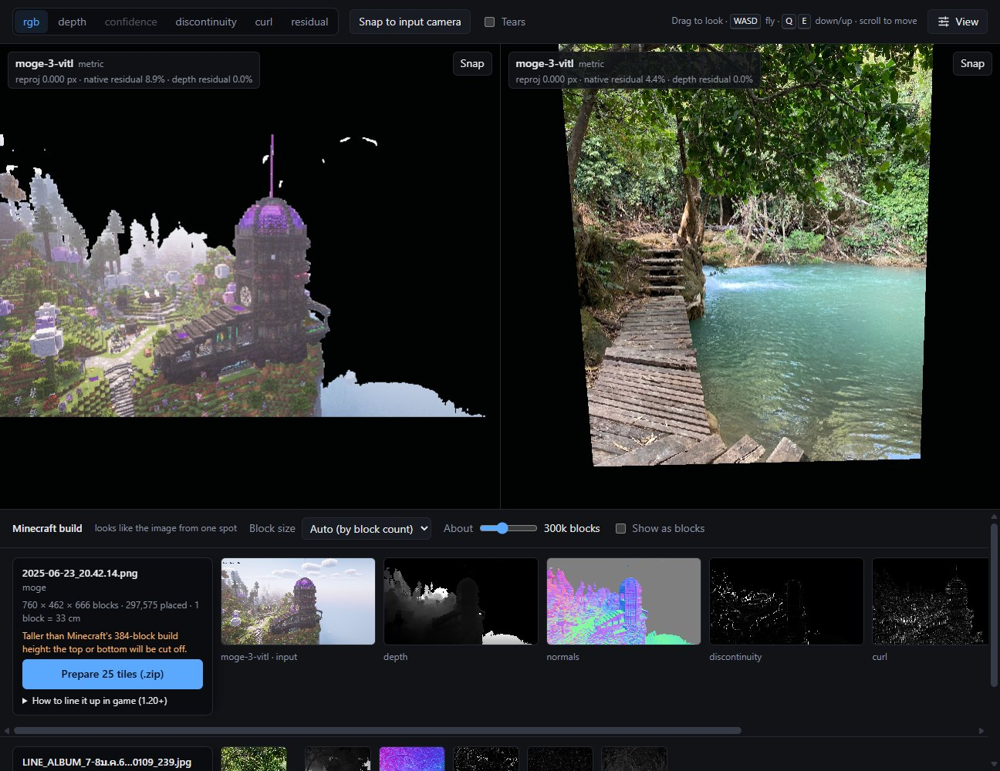

# The single-image 3D lab

[← README](../README.md)

BlockShot grew out of a tool for studying how monocular 3D models handle images, especially optical
illusions and impossible figures. All of that is still here.



- **Exact camera.** The 3D view projects through each run's own intrinsics, so **Snap to input
  camera** reproduces the input pixel for pixel.
- **Comparison grid.** Tick up to four runs in History. Moving in one panel moves all of them;
  poses are shared in units of each cloud's median depth, so metric and relative models stay aligned.
- **Navigation.** First person: drag to look around from where you stand, scroll to move forward
  or back. **W/A/S/D** fly, **Q/E** down/up, **Shift** faster, with speeds and point size under
  **View** in the toolbar.
- **Colour modes:** RGB, depth, confidence, discontinuity, curl, residual.
- **2D strip:** input, depth, confidence, normals and analysis maps. Click any image to enlarge it.
- **Integrability** (`backend/analysis/integrability.py`): how much of a model's predicted normal
  field no real surface could produce.
  - It uses a Helmholtz–Hodge split (a Poisson solve) on the perspective-exact gradient
    `∇log z = −(nₓ, n_y)/(n·r)`, where r is the pixel's viewing ray.
  - Depth-derived gradients score 0 by construction.
  - A synthetic sphere scores 0.05%, and a hand-built Penrose-triangle normal field scores 22%,
    spread around the loop.
- **Tears** (`discontinuity.py`): depth jumps scaled by distance, with the top 20 marked in 3D and on
  the image.
- **Off-axis renders** (`offaxis.py`): the cloud re-rendered at ±5°, ±15° and ±30°, to watch an
  illusion fall apart as you leave its viewpoint.
- **Reprojection check** (`reproject.py`): 0.000 px for every depth model.

`samples/generate.py` draws a Penrose triangle and a Necker cube; `samples/` also has a few rendered
3D figures as controls. A CLI writes runs too:

```bash
uv run python -m backend.cli predict samples/penrose_triangle.png --model moge
```

Each run is cached in `runs/<image sha>_<model>_<version hash>/` as `prediction.npz`, `points.ply`
(RGB, camera frame: +X right, +Y down, +Z forward), `input.png` and `meta.json`.
